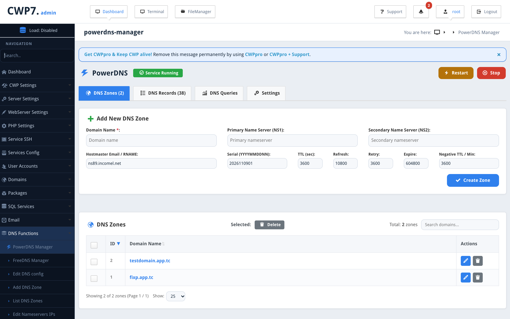
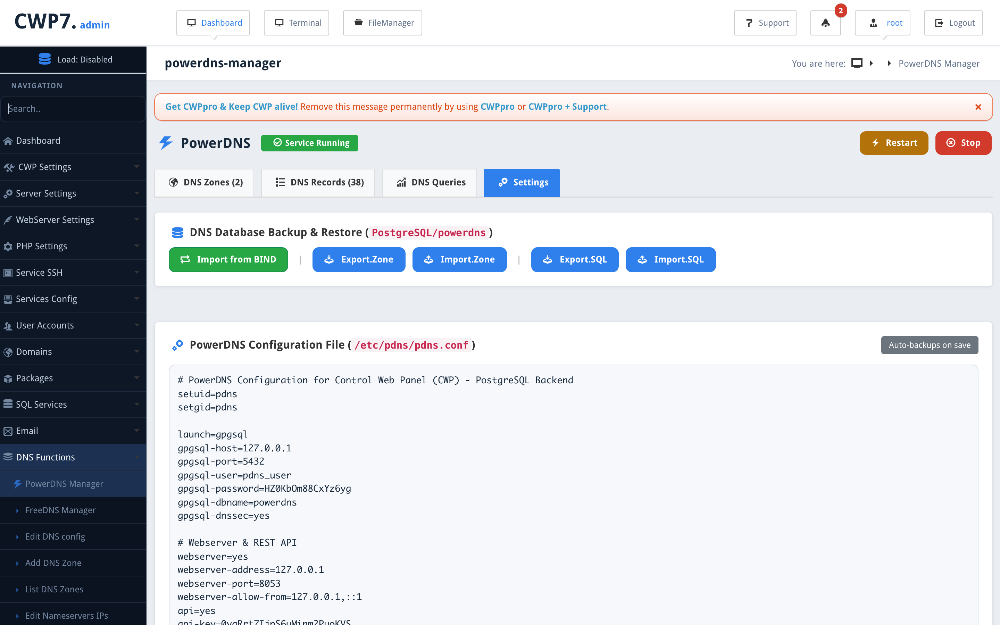

# PowerDNS Management Module for Control Web Panel (CWP)

A high-performance, native PowerDNS Authoritative Server management module designed for [Control Web Panel (CWP)](https://control-webpanel.com/).

---

## 📸 Screenshots

### DNS Zones Management


### Universal Backup & Restore & Configuration Editor


---

## ✨ Key Features

- **🌐 Comprehensive Zone Management**: Create, list, search, filter, and delete forward and reverse DNS zones (Native & Master).
- **📝 Complete Record Editor**: Manage `A`, `AAAA`, `CNAME`, `MX`, `TXT`, `SRV`, `NS`, `CAA`, `PTR`, and `SOA` records with inline comments and bulk status controls (Active / Passive / Delete).
- **🔄 Non-Destructive BIND 9 Import ("Import from BIND")**: One-click action button on the **Settings** tab that scans `/var/named` and imports missing zones and records into PowerDNS without overwriting existing records.
- **🗄️ Multi-Database Backend Support**: Seamless choice between **MySQL** and **PostgreSQL**. The installer auto-detects if PostgreSQL is installed on the system and presents an interactive 10-second selection prompt (defaulting to MySQL).
- **💾 Full SQL Database Backup & Restore (`Export.SQL` / `Import.SQL`)**: Instant one-click SQL export and web file import of the entire PowerDNS database (supporting both `mysqldump` and `pg_dump`) with optional automatic service restart.
- **📄 Universal RFC 1035 ZoneFile Export & Import (`Export.Zone` / `Import.Zone`)**: Database-agnostic DNS backup and restore. Export all zones as standard RFC 1035 `.zone` files and import them seamlessly across MySQL and PostgreSQL without any SQL syntax conflicts.
- **📊 Real-time DNS Analytics & Query Logging**: Integrated high-speed background daemon capturing incoming queries, domains, query types, response codes, client IPs, protocols, and packet sizes into MySQL or PostgreSQL.
- **⚙️ In-Browser Config Editor**: Full-featured editor for `/etc/pdns/pdns.conf` with automatic timestamped backups, syntax validation, and instant service restart.
- **🛡️ High-Availability Fallback**: Direct database queries (MySQL or PostgreSQL) when the PowerDNS daemon is stopped, ensuring records remain viewable and manageable.
- **🎨 Standardized CWP Design**: Form submissions in CWP blue (`#2f80ed`), delete actions in grey (`#6c757d`), sync actions in green (`#28a745`), and uniform left-aligned data tables.

---

## 🚀 Installation

Run on your CWP server as `root`:

```bash
curl -fsSL https://raw.githubusercontent.com/QadirAdamson/CWP-Module-PowerDNS-Manager/main/install.sh | bash
```

Access in CWP Admin Panel: 👉 **DNS Functions → PowerDNS Manager**

---

## 🗑️ Uninstallation

Run on your CWP server as `root`:

```bash
curl -fsSL https://raw.githubusercontent.com/QadirAdamson/CWP-Module-PowerDNS-Manager/main/uninstall.sh | bash
```

*(Automatically restores and re-enables BIND `named` service on port 53).*

---

## 📄 License

This project is open-source and licensed under the [MIT License](LICENSE).
